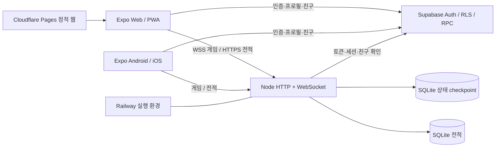

# 아키텍처와 보안 경계

확인: 2026-11-17, codex/tempo-hand-history 작업 트리. 배포 상태는 [현재 상태](PROJECT_STATUS.md).

호스팅은 저장소 배포 설계이며 실제 배포 버전 일치를 뜻하지 않는다.

## 책임 및 데이터 흐름

1. [앱 진입](../apps/mobile/App.tsx)이 계정/홈/방을 구성한다. screens와 components는 표시·입력 담당. 플랫폼별 .web.ts/.web.tsx와 기본 파일로 웹/네이티브 경로를 분리한다.
2. [useAccount](../apps/mobile/src/hooks/useAccount.ts), [anonymousSession](../apps/mobile/src/services/anonymousSession.ts)이 세션 재사용 또는 익명 가입, 닉네임 온보딩을 수행한다. 기존 계정 표식/복구 실패를 새 UUID 생성으로 숨기지 않는다. 웹 저장과 네이티브 SecureStore 경로는 분리된다.
3. [RoomClient](../apps/mobile/src/services/RoomClient.ts), [useRoom](../apps/mobile/src/hooks/useRoom.ts)이 생성/참가/행동을 전송한다. [index](../apps/server/src/index.ts), [http](../apps/server/src/http.ts), [lobby](../apps/server/src/lobby.ts)가 HTTP/WS·방·권한·타이머를 처리한다. [accountSession](../apps/server/src/accountSession.ts)은 토큰/현재 세션을 확인한다. 사용자 제공 ID를 권한 근거로 신뢰하지 않는다.
4. 서버가 정원 6명·차례·금액·방장 설정 권한을 검증한다. [hand](../apps/server/src/holdem/hand.ts)가 덱·패·팟·정산을 관리한다. [공통 프로토콜](../packages/shared/src/index.ts), [홀덤 타입](../packages/shared/src/holdem.ts)의 구·신 호환성을 유지한다.
5. 재접속/활성화 시 인증된 currentRoom으로 최신 참여 상태를 복원한다. 웹 [sessionStore](../apps/mobile/src/services/sessionStore.web.ts)는 방 토큰을 영구 저장하지 않는다. 명시적 퇴장과 단절을 구분하며 기본 좌석 보존은 [config](../apps/server/src/config.ts)의 300000ms다.
6. [stateStore](../apps/server/src/stateStore.ts)는 방/핸드/최근 리뷰 checkpoint를 저장한다. 개발은 STATE_DB_PATH 없이 메모리 실행 가능하지만 운영은 경로 필수다. 비공개 패도 저장되므로 외부 공개 금지. nextHandAt 자체는 checkpoint 미포함이다.
7. 종료 핸드는 [FriendStatsStore](../apps/server/src/FriendStatsStore.ts)에 중복 핸드 ID 없이 집계된다. [friendStatsApi](../apps/server/src/friendStatsApi.ts)는 유효 세션과 수락된 친구를 검사하고 본인-친구 숫자 통계를 응답한다. P2 두 친구 비교는 동일 사용자 토큰으로 can_compare_friend_stats RPC의 세 수락 관계를 확인한 뒤 기존 SQLite compare를 호출한다. 신규 RPC 자체도 JWT authenticated 역할과 006의 read_account_session으로 최신 세션을 검사한다. postgres owner와 제한된 ACL을 사용하는 SECURITY DEFINER이며 서버는 publishable key만 허용한다. 신규 RPC는 [SQL 초안](../supabase/drafts/007_friend_stats_permission.sql)이며 운영 미적용이다. 클라이언트 통계 업로드 경로는 없다.

## 기록·오디오·보안

[Supabase migrations](../supabase/migrations/)는 프로필·친구·최신 세션의 RLS/RPC를 정의한다. 방 상태를 Supabase로 동기화하지 않는다. 파일 존재는 운영 적용 증거가 아니다.

[reviewFor](../apps/server/src/holdem/review.ts)는 공개 기록에 조회자 본인의 패만 보충한다. [HandReview](../apps/mobile/src/components/HandReview.tsx)는 최근 10핸드/핸드당 150이벤트를 소비한다. 누적 전적이 전체 액션 영구 보관을 뜻하지 않는다. 다른 사람의 미공개 패 필터는 서버 책임이다.

[cardPresentation](../apps/mobile/src/services/cardPresentation.ts), [audioScheduler](../apps/mobile/src/services/audioScheduler.ts), [useGameAudio](../apps/mobile/src/hooks/useGameAudio.ts)는 서버 이벤트/기한과 시각·사운드를 연결한다. 재접속은 오래된 사운드 재생이 아니다.

[origins](../apps/server/src/origins.ts)의 Origin 허용 정책과 JWT/세션/친구 검증을 함께 유지한다. Origin 없는 native도 인증이 필요하다. 토큰을 URL에 넣거나 비밀키를 공개 번들에 넣지 않는다. 단일 서버·SQLite 볼륨이므로 단순 replica 확대는 지원 설계가 아니다. 백업/운영/승인은 [웹 배포 절차](web-deployment.md) 참조.
