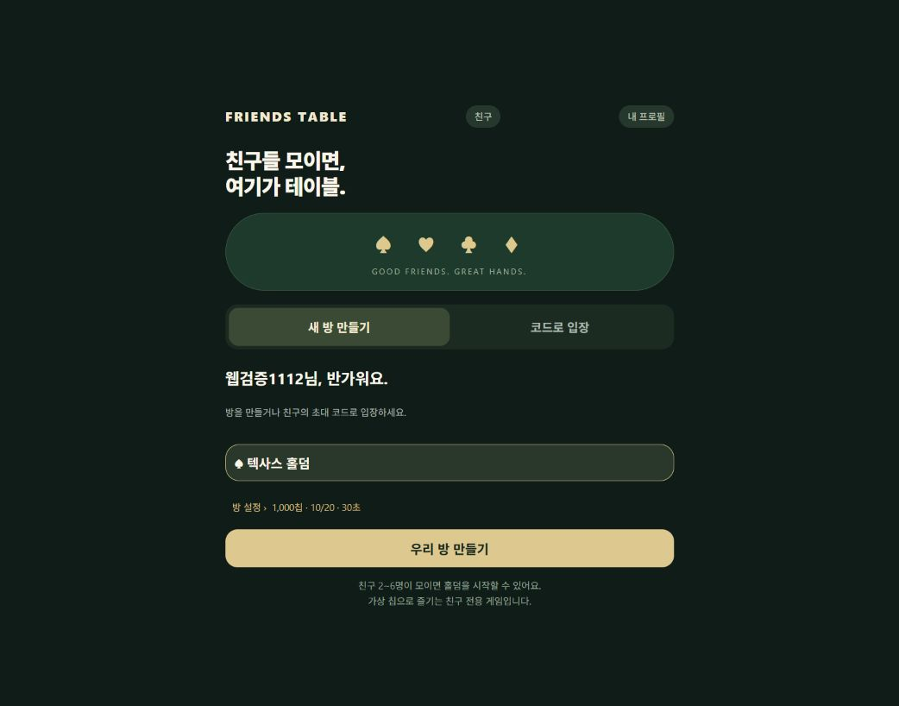

# 2단계: Expo Web 실행·기본 인증 검증

2026-11-12 / 저장소 `play-ui-refresh`, branch `main`, 기준 HEAD `a666688`.

## 결과

Expo Web 개발 서버, 웹 번들, 실제 Supabase 익명 로그인 → 닉네임 저장 → 홈 → 새로고침 복귀를 확인했다. 로컬 Node HTTP + ws 서버의 기존 인증을 거친 `currentRoom` 요청과 `noRoom` 응답도 확인했다. 게임 플레이·친구 전적·PWA 완료를 의미하지 않는다.

작업 시작 시 미커밋 파일은 1단계 분석 문서 두 개였으며 보존했다. 사용자가 복사한 `apps/mobile/.env.local`은 읽어서 사용했지만 수정하지 않았으며 Git ignored/untracked 상태를 확인했다. 설정값·토큰은 문서에 기록하지 않는다. DB 스키마·게임 규칙·서버 코드·운영 배포는 변경하지 않았다.

## 의존성과 변경 파일

`apps/mobile`에서 `npx expo install react-dom react-native-web` 실행. 설치 버전: **react-dom 19.3.0, react-native-web 0.21.4**. package.json 범위는 Expo 설치 결과인 19.3.0 / ^0.21.4. lockfile 비교에서 기존 패키지 버전 변경은 0개이고 신규 전이 의존성을 포함해 20개 항목이 추가되었다. 별도 metro-runtime이나 광고 패키지는 설치하지 않았다. [Expo 공식 웹 안내](https://docs.expo.dev/workflow/web/)

| 파일 | 변경 |
|---|---|
| `apps/mobile/package.json`, `package-lock.json` | 웹 의존성, 모바일 test 및 export:web 스크립트 |
| `.github/workflows/check.yml` | 기존 검사를 유지하며 모바일 테스트와 웹 export 단계 추가. 원격 CI 자체는 미실행 |
| `src/services/accountStorage.ts` | 기본/native SecureStore 분할 저장 어댑터 분리. 기존 키/형식 그대로 |
| `src/services/accountStorage.web.ts`, `browserStorage.ts` | localStorage 어댑터, 저장 가능 여부 확인, 세션/계정 표식 검증, 안전한 오류 |
| `src/services/settingsStorage.ts`, `.web.ts` | native SecureStore 유지, 웹 음량 설정 분리·유효성 검사 |
| `src/services/sessionStore.web.ts` | 웹 방 복귀 자격증명은 저장하지 않고 서버의 인증된 참여 상태로 복구 |
| `src/services/authClient.ts`, `src/hooks/useAccount.ts` | 플랫폼 어댑터 연결 및 새 익명 계정 생성 전 저장 가능 여부 확인 |
| `src/hooks/useGameAudio.ts` | 음량 저장소 경계 사용. 오디오 재생·게임 규칙 변경 없음 |
| `src/services/authErrors.ts`, `src/screens/AccountScreen.tsx` | 저장소 오류 안내, 브라우저/시크릿/기기 변경 시 익명 계정 복구 제한 안내 |
| `src/services/serverUrl.web.ts`, `webEndpoint.ts`, `.env.example` | 웹 주소 처리 및 선택적 WEB_GAME_SERVER_URL 문서화 |
| `App.tsx` | 웹에서 지원하지 않는 BackHandler 등록을 생략. native는 기존 동작 |
| `test/audio-hook.test.cjs` | 테스트의 저장소 mock 경계를 새 어댑터에 맞춤. 기존 테스트 유지 |
| `test/web-storage.test.cjs` | 웹/native 저장소·SDK 복구/갱신/로그아웃·주소 테스트 10개 |
| `docs/web-phase2-validation.md`, `docs/web-phase2-home.jpg` | 이번 보고서와 실제 홈 화면 캡처 |

표의 `src`, `test`, `.env.example`, `App.tsx`는 `apps/mobile` 기준이다.

## 저장 데이터와 보안 경계

- 인증: web localStorage의 `friends-table.auth.v1.` namespace에 Supabase SDK가 관리하는 세션을 원자적인 단일 값으로 저장한다. 계정 UUID 표식은 세션 소실 후 다른 익명 계정을 자동 생성하지 않도록 유지한다. 데이터 형태/길이를 검증하지만 클라이언트 검증을 서버의 JWT 인증 대체로 사용하지 않는다.
- 방: native `sessionStore.ts` 및 WHEN_UNLOCKED_THIS_DEVICE_ONLY 옵션은 수정하지 않았다. 웹의 authenticated RoomClient는 원래부터 `currentRoom`을 우선하므로 별도 방 토큰을 localStorage/sessionStorage에 중복 보관하지 않는다. 웹 무인증 legacy resume는 이번 제품의 지원 경로가 아니다.
- 설정: `friends-table.settings.v1.` namespace에서 음량/뮤트/이벤트별 gain 범위를 검사한다. 잘못된 설정은 오류로 보고하며 기본 UI를 유지한다. 게임 인증과 저장 영역을 분리했다.
- 삭제: Supabase SDK의 removeItem/signOut에 따라 인증 토큰과 부속 키를 삭제한다. 익명 계정 보호 UUID 표식과 음량 설정은 유지한다. 현재 제품에 없는 로그아웃 버튼이나 계정 삭제 기능을 추가하지 않았다. 웹 방 토큰은 애초 영구 저장하지 않는다.
- 저장소 접근 거부/용량 초과/손상은 비밀정보 없는 고정 오류로 변환한다. 저장소를 조용히 메모리로 대체하거나 손상 세션을 자동 삭제하지 않는다. 사전 write/read/delete probe 실패 시 익명 계정 생성 경로로 진행하지 않는다.
- 브라우저 localStorage는 native Keychain/Keystore와 같은 비밀 저장소가 아니다. XSS·제3자 스크립트 접근 위험은 남으며 배포 시 CSP 등은 후속 배포 보안 범위다. 인증 토큰을 URL에 넣지 않는다. 현재 계정 연결/OAuth 기능은 추가하지 않았다.

## 네트워크 처리

웹 주소 선택 순서는 `EXPO_PUBLIC_WEB_GAME_SERVER_URL`(선택) → 기존 `EXPO_PUBLIC_GAME_SERVER_URL` → 개발 HTTP 페이지의 hostname:3000 이다. native는 기존 GAME_SERVER_URL 로직 그대로다.

- 개발의 10.0.2.2는 브라우저 hostname으로만 변환하고 설정 port/path를 보존한다. PC localhost와 휴대폰 LAN 접속을 단위 테스트했다.
- 현재 사용자가 제공한 설정은 에뮬레이터 주소가 아닌 localhost 주소였다. 로컬 게임 서버 미실행 상태의 접속 실패를 확인한 뒤 서버를 실행하여 정상 조회를 확인했다.
- HTTPS 페이지에서 ws 주소는 거절한다. 운영에서는 공개 WSS를 명시해야 하고 URL의 토큰 query/userinfo/hash도 기존 endpoint 검증으로 거절한다. 주소를 자동 HTTPS/WSS로 바꾸어 서버 TLS 지원을 추측하지 않는다.
- 웹 override를 사용하더라도 APP_ENV=production/preview의 기존 공통 app.config 검증은 GAME_SERVER_URL에 유효한 공개 WSS를 요구한다. 두 주소가 다르면 둘 다 올바르게 설정한다.
- HTTP 친구 전적 preflight를 인증정보 없이 로컬에서 검사: OPTIONS 응답 404, Access-Control-Allow-Origin 없음. **다른 origin의 친구 전적 조회는 아직 불가**. Supabase HTTPS API의 익명 로그인·프로필 저장/조회는 실제 브라우저에서 성공했다.
- WS Origin allowlist는 아직 서버에 없다. 이번 단계는 기존 JWT 권한 검증을 유지했으며 wildcard CORS나 인증 우회는 추가하지 않았다. 외부 웹 배포 전 정확한 allowlist와 native의 Origin 없는 연결 정책을 별도 서버 변경으로 구현해야 한다.

## 실제 테스트 결과

| 검사 | 결과 및 한계 |
|---|---|
| 변경 전 `npm run typecheck` | 통과 |
| 변경 전 모바일 테스트 | 28/28 통과 |
| 변경 후 `npm run typecheck` | 전체 workspace 통과 |
| `npm test` | 기존 서버·통신 테스트 167/167 통과. localhost 통신 가능한 환경에서 실행 |
| `npm run test --workspace=@boardgame/mobile` | 기존 28 + 신규 10 = **38/38 통과** |
| `npx expo export --platform web` | 성공 |
| `npx expo export --platform web --platform android --platform ios` | 세 플랫폼 번들 모두 성공. APK/IPA 컴파일·기기 실행과는 다름 |
| `npx expo start --web --localhost --port 8087` | 실제 개발 서버 및 웹 번들 응답 성공 |
| 브라우저 최초 접속 | 인앱 Chromium 브라우저에서 계정 준비 → 실제 Supabase 익명 로그인 → 닉네임 설정 표시 확인 |
| 닉네임·홈 | 검증용 닉네임 저장 후 홈 렌더링 확인 |
| 새로고침 복구 | 반복 reload 후 기존 닉네임·프로필로 복구, 재가입/닉네임 설정 화면으로 되돌아가지 않음 |
| 브라우저 WS | 기존 서버 인증 포함 currentRoom → noRoom → 사용 가능한 홈 화면 확인. 방 미참여 때 연결 종료는 정상 동작 |
| 런타임 오류 | 최초 BackHandler 오류 수정. 최종 서버 재시작/페이지 reload 이후 수집한 로그에서 warn/error 없음. 모든 후속 화면의 무오류를 보장하지 않음 |
| 저장소 read/write/delete·차단·용량·손상·platform | 실제 어댑터를 사용한 단위 테스트 통과. 브라우저 사이트 설정을 변경해 저장 차단을 재현한 실기 테스트는 하지 않음 |
| Supabase 복구·토큰 갱신·로그아웃 | 설치된 실제 SDK + 테스트 응답/저장소로 검증. 실제 서비스의 장시간 토큰 만료/refresh 대기는 미실행 |
| Android/iOS | 기존 native 저장 형식/옵션 테스트 + 양 플랫폼 export 통과. 이번 작업에서 에뮬레이터/실기 조작·APK/IPA 빌드는 미실행 |
| iPhone Safari·PWA·게임 전체·혼합 멀티플레이 | 미검증, 이번 단계 완료 주장에 포함하지 않음 |

개발 서버를 최초 CI 모드로 실행했을 때 파일 감시가 꺼져 수정 전 번들이 계속 제공되는 문제가 있었다. 서버를 CI 모드 없이 `--clear`로 재시작하고 최종 페이지를 reload하여 수정본의 경고/오류가 없음을 확인했다.

새 익명 테스트 계정/닉네임은 사용자가 지정한 Supabase 개발 설정으로 생성했다. 기존 계정을 변경하거나 삭제하지 않았으며 테스트 계정도 임의 삭제하지 않았다. 캡처는 토큰/환경변수/친구 코드를 포함하지 않는 홈 화면이다.

검사 로그는 저장소 루트 `web-phase2-*.log`이며 Git ignored다. 원격 CI 결과나 과거 테스트 결과를 이번 검증으로 보고하지 않았다.



## 실행 방법

저장소 루트에서 서버를 실행한다.

```powershell
npm run server
```

다른 터미널에서:

```powershell
cd apps/mobile
npx expo start --web
```

이번 검증 서버는 게임 3000, 웹 [localhost:8087](http://localhost:8087)로 실행했다. 포트 충돌을 피하려면 `--localhost --port 8087`을 사용한다. 휴대폰 테스트는 localhost 옵션 대신 LAN 접근이 가능한 개발 서버 설정과 PC LAN 게임 주소를 사용해야 한다. 환경변수 변경 후 Expo를 재시작한다.

## 다음 단계

1. 웹 확인창(Alert: 나가기/올인 등), 공유 대체, HTTPS 초대 링크를 구현한다. 현재 해당 기능은 웹 완료가 아니다.
2. 친구 전적 HTTP CORS와 WS Origin allowlist를 인증 구조를 유지하며 구현하고 오류 응답/OPTIONS/native 회귀를 검사한다.
3. 브라우저 탭 복귀·다중 탭 동시 최초 로그인·연결 대체·실게임 재동기화, 웹/Android 혼합 플레이를 검증한다.
4. 게임 테이블 반응형·Safari 음원 및 드래그·실제 iPhone 테스트 후 PWA 단계를 진행한다.

광고·리바이 승인·전체 방 목록·DB 변경·게임 엔진 변경·운영 배포는 수행하지 않았다.
