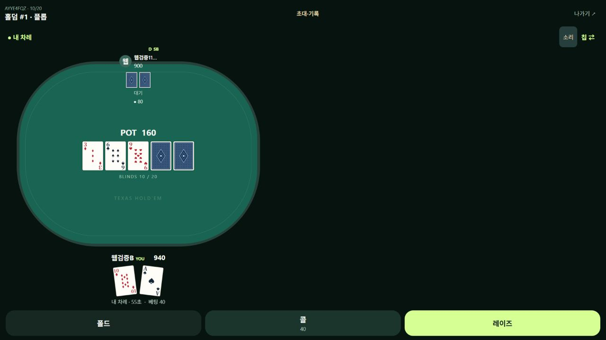

# 3단계 웹 친구·방·실시간 검증

검증일: 2026-11-15 (KST). 저장소 `play-ui-refresh`, 브랜치 `main`.
1·2단계의 미커밋 변경을 보존했으며 이번 단계에 패키지 설치, DB 스키마 변경, 게임 엔진 변경, 외부 배포는 없다.
`.env.local`은 수정하거나 Git에 추가하지 않았으며 설정값·토큰을 보고서에 포함하지 않는다.

## 구현과 변경 파일

| 파일 (저장소 기준) | 변경 |
| --- | --- |
| `apps/mobile/src/services/platformUI.tsx`, `platformUI.web.tsx` | 네이티브 Alert/Share 유지. 웹 확인창의 취소·승인 콜백, 클립보드 복사, 선택 가능한 공유 문구와 선택적 기기 공유. 복사 거부/응답 지연 시 수동 복사 대체 UI |
| `apps/mobile/App.tsx` | 전역 웹 확인창 호스트. 인증·닉네임·서버 참여 조회 완료 후 초대 입장. 같은 방은 복귀, 다른 방은 확인 후 서버 퇴장 완료를 기다려 입장 |
| `apps/mobile/src/services/invite.ts`, `shareInvite.ts`, `shareInvite.web.ts`, `consumeInvite.ts`, `consumeInvite.web.ts` | `/join/CODE` URL. 토큰 없는 초대 문구. HTTPS 운영 origin 설정. 기존 앱/Expo 링크 보존. 처리한 웹 초대 경로 제거 |
| `apps/mobile/src/services/RoomClient.ts` | 서버 조회 완료 상태와 웹 재동기화 메서드. 기존 중복 연결 교체 정책 유지 |
| `apps/mobile/src/services/roomLifecycle.ts`, `roomLifecycle.web.ts`, `apps/mobile/src/hooks/useRoom.ts` | 네이티브 AppState 유지. 웹 visibilitychange/pageshow/online 복귀 시 인증된 최신 스냅샷 조회, 해제 시 이벤트 정리 |
| `apps/mobile/src/screens/FriendsScreen.tsx`, `GameScreen.tsx`, `LobbyScreen.tsx`, `apps/mobile/src/components/RoomRecords.tsx` | 플랫폼 UI 어댑터 사용. 게임 퇴장 확인을 App 한 곳으로 통합 |
| `apps/server/src/origins.ts`, `config.ts`, `http.ts`, `lobby.ts`, `index.ts` | 정확한 허용 Origin 목록, HTTP CORS/preflight, WebSocket 업그레이드 전 Origin 검사 |
| `apps/mobile/.env.example`, `apps/server/.env.example` | 공개 웹 origin 및 서버 허용 origin 설정 설명 |
| `apps/mobile/test/web-ui.test.cjs`, 기존 `FriendsScreen.test.cjs`, `game-ui.test.cjs` | 확인창·공유·복사 실패·생명주기 테스트, 기존 테스트의 어댑터 mock |
| `apps/server/test/web-origins.test.ts`, `invite.test.ts`, `multiplayer.test.ts` | Origin/인증, 초대 URL, 저장된 방 토큰 없는 게임 중 복귀·비공개 카드 회귀 테스트 |
| `.gitignore`, 이 문서, `docs/web-phase3-restored.jpg` | 분리한 웹 산출물 제외, 검증 기록과 복구 화면 |

작업 트리에는 위 목록 외에 기존 2단계 저장소·인증·의존성·CI 변경도 남아 있다. 그 변경은 `web-phase2-validation.md`를 참조한다.

## 인증 기반 방 복귀

기존 서버에 **WebSocket `currentRoom` API가 이미 존재**한다. 별도 HTTP 참여 조회 API나 중복 DB 구조를 추가하지 않았다.

1. Supabase 인증 세션을 복원한 뒤 현재 access token을 가져온다.
2. WebSocket 메시지의 access token을 서버에서 검증한다. 브라우저 WebSocket은 사용자 지정 Authorization 헤더를 지원하지 않으므로 기존 메시지 인증 방식을 유지한다. URL에는 토큰을 넣지 않는다.
3. 서버는 검증 결과의 `accountId`와 `sessionId`로 참여자를 찾는다. 클라이언트가 지정한 사용자 ID나 방 코드로 권한을 결정하지 않는다.
4. 기존 좌석으로 연결을 교체하고 `snapshot(room, playerId)`로 개인화한 상태를 보낸다. 본인의 카드·칩·턴·팟은 서버 기준이며 상대의 비공개 카드는 `null`이다. 정상 올인 공개/쇼다운은 기존 엔진 규칙에 따른다.
5. 웹 `sessionStore.web.ts`는 방 토큰을 localStorage/sessionStorage에 저장하지 않는다. 인증 세션만 기존 2단계 웹 저장소를 사용한다. 네이티브 SecureStore 방 복귀는 보존한다.

복귀 보장에는 **기존 서버 참여 보존 기간**이 적용된다. 기본 `RECONNECT_MS=300000`(5분), 설정 허용 범위 30초~30분이다. 탭 종료 후 장시간 경과, 명시적 퇴장, 방 종료, 세션 교체/계정 소실 시 무조건 같은 좌석을 복구하는 기능은 아니다. 서버 재시작 보존은 기존 `STATE_DB_PATH` 영속 볼륨 설정에 의존한다. 게임의 턴 타이머는 연결이 끊겨도 서버에서 계속 진행한다.

## 실제 브라우저 검증

Codex 내장 Chromium 브라우저에서 `localhost:8087`의 사용자 A와 `127.0.0.1:8087`의 사용자 B를 별도 origin/인증 세션으로 실행했다. 실제 개발용 Supabase 익명 인증과 로컬 Node/ws 서버를 사용했다. 엔진·인증 mock으로 대체하지 않았다.

| 항목 | 실제 결과 |
| --- | --- |
| 익명 초대 방문 → 닉네임 → 자동 입장 | B 신규 익명 계정 설정 후 A의 방에 입장, 참가자 2/6 |
| 방 생성/코드 입장/퇴장/홈 복귀 | A 생성, B 코드 재입장, 퇴장 취소 및 확정, 홈에서 참여 상태 유지 확인 |
| 방장 설정 | 30초→120초 변경이 두 화면에 반영. 비방장 화면에는 설정 버튼 없음 |
| 친구 | A→B 요청, B 거절, 재요청 수락, 친구 목록 확인 |
| 친구 전적 HTTP/CORS | 실제 2판, A 팟 획득 2회/B 0회, 칩 증감 +1000/-1000 조회 |
| 멀티플레이 | 콜10, 체크, 플롭 베팅40, 레이즈80, 폴드, 다음 판 자동 시작 |
| 올인/결과/재준비 | B 940 올인, A 콜920, 팟1880, 정상 쇼다운, A2000/B0 결과, 방장 새 경기 준비 동기화 |
| 게임 중 새로고침 | B 동일 좌석, 10다이아/A스페이드, 980칩 복구. A 행동 이후 최신 팟40/본인 차례 수신 |
| 탭 종료 후 재접속 | 같은 B origin 루트로 새 탭. 플롭에서 동일 패·940칩, A 레이즈 후 팟160/본인 차례 복구 |
| 네트워크 단절/재연결 | 로컬 TCP 전달 경로만 중단하고 게임 서버 유지. 연결 복구 중 표시·액션 비활성화 후 자동 재접속. 동일 패·940칩·팟160·진행 중 턴 복구, 이후 폴드 성공 |
| 비공개 카드 | 복구 전후 상대 패 뒷면. 본인 패만 확인. 올인 콜 완료 후에만 기존 공개 규칙에 따라 표시 |
| 같은 계정 중복 연결 | 새 탭은 같은 좌석, 2/6 유지. 기존 탭은 다른 연결 안내와 명시적 다시 시도, 자동 점유 반복 없음 |
| 동일 방 초대 다시 열기 | 같은 방으로 복귀, 참가자 중복 증가 없음, URL 경로 처리 후 루트 |
| 잘못된/닫힌 방 링크 | 잘못된 코드 안내, 마지막 참여자 퇴장으로 닫힌 방은 입장 실패 안내 |
| 복사/공유 | 방 코드 클립보드 복사 완료, 토큰 없는 링크와 코드의 선택·복사 대체 화면 확인 |

네트워크 시험은 localhost 전용 TCP 프록시 3010→3000을 사용했다. sandbox 안에서 다시 띄운 프록시는 upstream 연결이 막혀 복구하지 못했고, 허용된 로컬 실행으로 재시작한 뒤 실제 자동 재연결을 확인했다. 앱 코드나 인증을 우회한 프록시는 아니다. 일반 실행에서는 프록시가 필요 없다.

브라우저에서 발견한 플랫폼 파일 우선순위 문제(`platformUI.ts`가 `.web.tsx`보다 먼저 선택됨)를 네이티브 파일도 `.tsx`로 맞춰 수정했고, 이후 올인·퇴장·새 경기 확인창을 실제 재검증했다. 공유는 OS 공유창의 가용성에 의존하지 않도록 복사 화면을 먼저 제공한다.



## 자동 테스트와 빌드

| 명령 | 결과 |
| --- | --- |
| `npm test` | 서버 172/172 통과 |
| `npm run test --workspace=@boardgame/mobile` | 모바일 42/42 통과 (기존 38 + 웹 UI/생명주기 4) |
| `npm run typecheck` | mobile/server/shared 통과 |
| `npm run export:web --workspace=@boardgame/mobile -- --output-dir dist-web` | 웹 배포 번들 생성 성공 |
| `npm run export:mobile` | Android 및 iOS Hermes 번들 생성 성공 |
| `git diff --check` | 통과 |

초기에 새 복귀 테스트가 상대 카드 `undefined`를 기대하여 실패했다. 실제 기존 프로토콜은 `null`이므로 테스트를 그 규약에 맞추고 전체 서버 테스트를 재실행해 통과했다. 카드 공개 규칙은 수정하지 않았다.

보안 테스트에는 잘못된 Origin의 HTTP403/WS 업그레이드 거절, 허용 Origin의 정상 연결, 허용 Origin이어도 잘못된 JWT 거절, Origin 없는 네이티브 연결의 인증 요구가 포함된다. 기존 테스트는 다른 계정의 참여 조회/방 토큰 악용 방지와 권한·게임 규칙도 계속 검증한다.

## 로컬 실행 및 운영 준비

PowerShell, 저장소 루트의 서버 터미널:

```powershell
$env:WEB_ALLOWED_ORIGINS='http://localhost:8081'
npm run server
```

별도 모바일 터미널 (`apps/mobile/.env.local`의 기존 Supabase 설정 사용):

```powershell
cd apps/mobile
npx expo start --web --port 8081
```

포트/hostname이 다르면 서버 허용 목록을 **정확한 origin**으로 맞춘다. 여러 origin은 쉼표로 분리한다. 브라우저용 서버 주소가 별도일 때만 `EXPO_PUBLIC_WEB_GAME_SERVER_URL`을 설정한다. 2단계의 Android 에뮬레이터 주소 변환과 HTTPS→WSS 검증을 그대로 사용한다.

운영 환경:

- `EXPO_PUBLIC_WEB_APP_URL=https://<web-host>`: 끝 슬래시·경로·쿼리 없이 origin. 웹 기본값은 현재 origin이며 네이티브는 미설정 시 기존 앱 링크를 사용한다.
- `EXPO_PUBLIC_WEB_GAME_SERVER_URL=wss://<game-host>/lobby`: 브라우저에서 접근 가능한 TLS 주소. 공유 문구에는 서버 주소나 인증 토큰을 넣지 않는다.
- 서버 `WEB_ALLOWED_ORIGINS=https://<web-host>`: 빈 값은 브라우저 거부, 와일드카드 거부, production에서 HTTP 거부. Origin 없는 네이티브는 계속 JWT 검증을 거친다. Origin 검사는 인증의 대체물이 아니다.
- HTTPS 웹 호스팅에서 `/join/*`를 앱 index.html로 전달하는 SPA fallback을 구성한다. WebSocket reverse proxy는 Upgrade와 Origin 헤더를 유지해야 한다.
- Supabase 익명 인증 활성화와 기존 RLS/RPC를 유지한다. 공개 환경변수에는 service-role/관리 키를 넣지 않는다.
- 서버 상태/전적 DB의 영속 저장소, 기존 세션 만료와 재접속 보존 시간을 운영 요구에 맞게 설정한다.

## 미검증 범위와 다음 단계

- **iPhone Safari, Android Chrome, PC Chrome/Edge 개별 제품 실기 검증, 실제 OS 탭 백그라운드·화면 잠금, Android/웹 혼합 플레이는 미검증.** 내장 Chromium 결과를 이들 환경의 통과로 간주하지 않는다.
- visibilitychange/pageshow/online 처리는 자동 단위 테스트로 검증했으나 실제 모바일 OS의 장시간 정지·복귀는 별도 확인이 필요하다.
- Android/iOS 설치·기기 실행은 이번 단계에서 하지 않았다. 네이티브 회귀 범위는 기존 테스트와 양 플랫폼 번들이다.
- Safari에서는 HTTPS 개발/스테이징 주소에서 두 계정 게임을 시작하고 본인 패·칩·팟·차례를 기록한 뒤 새로고침/홈 전환/화면 잠금/비행기 모드 복귀를 각각 시험한다. 상대 패가 공개되지 않는지, 복구 대기 중 액션이 비활성인지 확인한다. 서버 보존 시간 초과 시 정상 만료 안내도 확인한다.
- 우선순위 1: 실제 Safari/Android 및 혼합 플레이, 운영 HTTPS/WSS·SPA fallback 검증. 우선순위 2: 기존 디자인을 유지하는 PC/가로 화면 반응형 조정. 우선순위 3: 별도 PWA 단계.
- PWA, 광고, 개별 리바이 승인, 공개 방 목록, DB 변경, 운영 배포는 이번 작업에서 수행하지 않았다.
