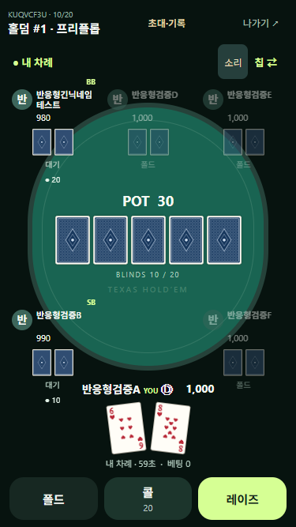
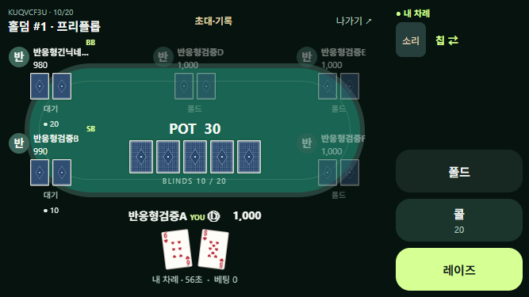
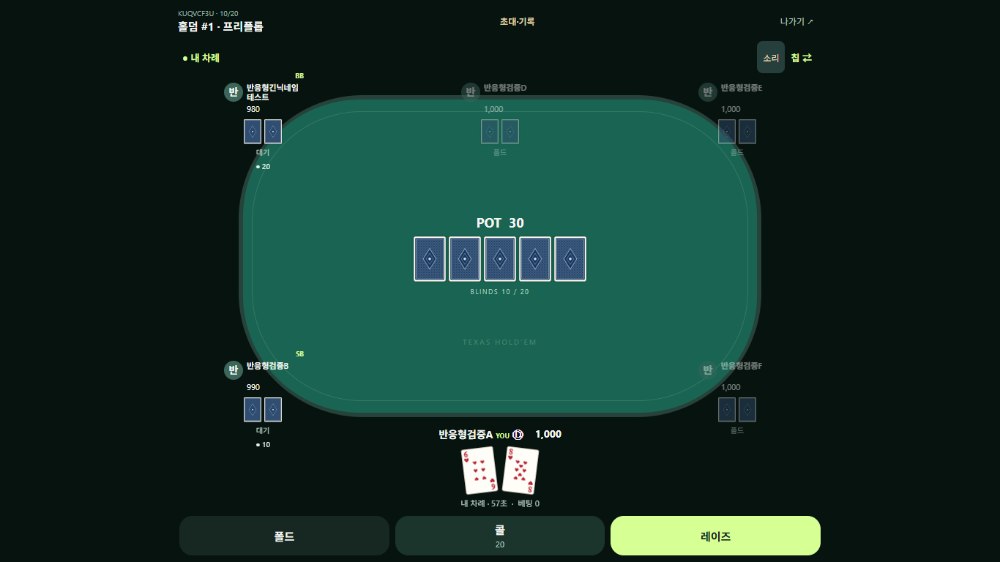

# 4단계 반응형 웹 UI 검증

검증일: 2026-11-15 KST. 저장소 `play-ui-refresh`, 브랜치 `main`.
2·3단계 문서와 미커밋 변경사항을 확인하고 보존했다. 변경 전 서버 172개, 모바일 42개 테스트가 통과했다. AGENTS.md가 지정한 [Expo 버전 문서](https://docs.expo.dev/versions/v57.0.0/)도 확인했다. 실제 프로젝트 패키지 버전은 기존 Expo 58 그대로다.

## 구현 범위와 파일

| 화면/파일 | 변경 |
| --- | --- |
| `apps/mobile/src/services/useWebLayout.web.ts` (신규), `useWebLayout.ts` (신규), `App.tsx` | 웹 전용 CSS와 viewport 수명주기. 네이티브 구현은 no-op. `100dvh`/`visualViewport.height`와 `innerHeight` fallback, resize 리스너 정리, viewport-fit=cover, 좌우 Safe Area. 핀치 줌을 차단하지 않으며 확대 중에는 레이아웃 높이를 바꾸지 않음 |
| `src/screens/GameScreen.tsx` | 중앙 정렬과 웹 스타일 표식, 동일 크기의 onLayout 업데이트 생략. 웹 타이머는 초가 바뀔 때만 React state를 갱신해 기존 250ms 폴링의 불필요한 렌더 감소 |
| `src/components/PokerTable.tsx` | 웹 좌석 폭 조정, 세로 화면 닉네임 두 줄, 짧은 가로 화면의 커뮤니티/본인 카드 크기 조정. 서버 순서·카드 공개·액션 규칙 그대로 |
| `src/screens/HomeScreen.tsx` | 웹 가로 화면에서도 친구·프로필 헤더 유지. 내용이 높이를 초과하면 접근 가능한 세로 스크롤 |
| `src/screens/AccountScreen.tsx` | 기존 입력·ScrollView를 유지하며 웹 viewport 스타일 적용 |
| `src/screens/FriendsScreen.tsx`, `FriendStatsScreen.tsx`, `LobbyScreen.tsx` | 웹 스타일 표식. 내용 최소 높이 보존·세로 스크롤·PC 최대 폭 제한 |
| `src/components/RoomSettingsEditor.tsx`, `RoomRecords.tsx`, `SoundSettings.tsx`, `HandReview.tsx`, `src/services/platformUI.web.tsx` | 웹 모달 높이를 가시 viewport에 제한, 긴 내용 내부 스크롤, 좌우/상하 Safe Area. 복기 화면 최대 폭 제한 |
| `test/game-ui.test.cjs`, `test/card-animation.test.cjs` | 기존 네이티브 테스트에 Platform mock을 명시. 기존 검증 내용 유지 |
| `test/web-ui.test.cjs` | viewport 축소·핀치 줌 보존·정리 테스트 1개 추가 |
| `.gitignore` | 임시 독립 브라우저 테스트 폴더 `.qa-web` 제외 |

위 `src`, `test` 경로는 `apps/mobile` 기준이다. 작업 트리에는 이전 단계의 변경도 남아 있으므로 전체 Git diff가 이번 단계만을 의미하지 않는다. 앱 의존성/lockfile은 이번 단계에서 변경하지 않았다. 로컬 QA 도구만 ignored `.qa-web`에 설치했다.

## 모바일·PC 배치

- 기존 색·테이블 펠트·카드·버튼 디자인 유지. PC 테이블 최대 폭 760px, 헤더/액션 최대 폭 900px, 테이블 높이 최대 700px로 중앙 배치한다.
- 세로 화면은 기존 테이블 아래 액션 배치다. 긴 닉네임은 두 줄이며, 가로 화면은 공간 때문에 한 줄 말줄임을 사용한다. 전체 닉네임은 접근성 이름에 유지한다.
- 600px 이상 폭/600px 이하 높이의 가로 화면은 왼쪽 테이블, 오른쪽 상태·액션으로 분리한다. 667×375와 844×390에서 본인 카드·커뮤니티 카드·액션이 함께 보인다.
- 주요 게임 액션은 세로·가로 모두 54px 높이로 측정했다. 버튼은 touch-action:manipulation 및 키보드 focus-visible을 지원한다. 사용자의 확대 접근성은 유지한다.
- 홈·친구·전적·대기실·모달은 콘텐츠가 많거나 키보드로 높이가 줄어들면 스크롤한다. 게임도 지원 크기보다 매우 낮은 세로 화면에서는 잘림 대신 스크롤 fallback을 사용한다.
- Safe Area와 가시 viewport 대응 코드는 구현했지만 iOS 주소창·실제 소프트 키보드의 동작 검증과 같지는 않다.

## 브라우저 검증 환경

처음에는 내장 Chromium으로 6개 독립 origin의 Supabase 익명 계정과 375×667 대기실을 확인했다. 이후 제공 도구가 바뀌고 개발 서버가 종료되어 별도 Playwright QA로 이어갔다. 설치된 **Chrome을 headless + 독립 프로필 + 브라우저 sandbox 유지** 상태로 실행하고, 6개 독립 브라우저 context에서 실제 Supabase 인증/닉네임/방 입장을 수행했다. 인증이나 서버 엔진을 mock으로 대체하지 않았다.

Chrome 테스트는 viewport와 터치 가능 설정을 사용한 데스크톱 엔진 테스트다. Android Chrome 실기 또는 iPhone Safari 테스트로 간주하지 않는다. Edge는 별도 headless 브라우저에서 동일 테스트 계정의 메모리 내 세션을 재사용하여 홈·친구 목록을 점검했으며, Edge의 전체 멀티플레이/신규 인증 검증을 주장하지 않는다. 세션 값을 출력하거나 파일로 저장하지 않았다.

### 6인 게임 화면 크기

다음 8개 크기에서 본인 + 상대 5명, 커뮤니티/본인 카드, 팟, 상태, 액션을 실제 렌더링하고 스크린샷을 확인했다. DOM 경계 측정 결과도 `web-phase4-viewports.json`에 저장했다. 본인 카드·커뮤니티·액션 경계가 viewport 안에 있고, 상대 좌석은 5개, 액션 버튼 3개는 모두 54px 높이였다.

| 크기 | 관찰 |
| --- | --- |
| 375×667 | 6인 카드/좌석과 하단 액션 표시, 긴 닉네임 두 줄 |
| 390×844 | 세로 테이블과 본인 카드/액션 표시 |
| 430×932 | 높이 상한으로 과도한 테이블 확장 제한 |
| 768×1024 | 중앙 배치, 테이블/액션 상한 유지 |
| 1366×768 | PC 중앙 배치와 폭 제한 |
| 1920×1080 | 화면 전체로 테이블/버튼이 늘어나지 않음 |
| 667×375 | 좌우 배치, 액션 54px, 본인 카드와 상태 표시 |
| 844×390 | 가로 배치, 카드·좌석·액션 경계 확인 |

### 기능과 다른 화면

| 검증 | 결과/범위 |
| --- | --- |
| 닉네임·홈 | 실제 익명 계정 닉네임 저장. 375×667 입력/홈, 667×375 홈 메뉴 확인 |
| 방/설정/대기실 | 실제 생성·초대 입장 6명, 120초 설정 변경, 375×667 6인 대기실 확인 |
| 멀티플레이 | A 레이즈80 → B 콜70 → C 콜60. 팟240과 플롭이 동기화. 이후 폴드로 A 지급240/1160칩 결과, 다음 핸드 진행 |
| 새로고침 | 핸드 진행 중 여러 reload 후 서버 방 복귀. 레이즈/콜 후 reload에서도 같은 패·920칩·팟240·플롭/상대 차례 복구 |
| 비공개 카드 | 상대 패 뒷면 유지. 카드 공개/서버 snapshot 코드를 변경하지 않음 |
| 결과·복기 | 375×667 결과와 6명 최종 손익/개인 패/비공개 패 복기 표시 |
| 베팅창 | 375×667 및 667×375에서 금액 입력·레이즈 제출. 버튼 오작동 없이 서버 액션 반영 |
| 확인창 | 가로 화면 퇴장 확인·취소 확인 |
| 음량 설정 | 375×667와 667×375. 긴 창 내부 스크롤 후 닫기 접근 성공 |
| 친구/전적 | 실제 친구 요청·수락, 375×667/667×375 목록·전적, 가로 전적의 새로고침 버튼까지 스크롤 접근 성공 |
| 짧은 입력 viewport | 375×400에서 프로필 입력·저장 버튼 확인. 실제 키보드 테스트는 아님 |
| Edge | 1366×768 홈과 친구 목록 렌더링 확인 |

친구/전적 등의 스크롤 화면은 한 장의 캡처에 모든 내용이 들어가는 구조가 아니다. 전적 갱신 후 위로 복귀하는 기존 동작도 유지했다. 게임 중심의 8개 크기 행렬과 달리 모든 보조 화면을 모든 크기로 조합하여 테스트하지는 않았다.

## 성능·안정성

같은 크기의 onLayout은 state를 다시 만들지 않는다. 웹 타이머는 초 단위로 갱신하지만 게임 서버의 타이머/명령은 변경하지 않았다. viewport 변경은 CSS 및 루트 높이에 반영하며 RoomClient를 재생성하지 않는다. 입력·리사이즈·새로고침·여러 플레이어 액션 중 화면과 게임을 계속 조작할 수 있었다.

기존 카드 애니메이션·reduced motion·복귀 테스트는 통과했다. 이번 작업은 FPS/GPU/장시간 메모리 프로파일링이나 실제 기기에서 깜빡임이 전혀 없다는 보증은 아니다. 이번 단계에서 실제 OS 탭 백그라운드·화면 잠금·네트워크 단절은 재시험하지 않았으며 3단계 결과와 구분한다.

## 회귀 결과

| 명령 | 결과 |
| --- | --- |
| 변경 전 `npm test` | 172/172 |
| 변경 전 `npm run test --workspace=@boardgame/mobile` | 42/42 |
| 변경 후 `npm test` | 172/172 |
| 변경 후 `npm run test --workspace=@boardgame/mobile` | 43/43 |
| `npm run typecheck` | mobile/server/shared 통과 |
| `npm run export:web --workspace=@boardgame/mobile -- --output-dir dist-web` | 최종 웹 번들 성공 |
| `npm run export:mobile` | Android/iOS Hermes 번들 성공 |
| `git diff --check` | 통과 |
| viewport JSON 경계 검증 | 8/8 통과 |

중간에 기존 카드 애니메이션 테스트의 React Native mock에 Platform이 없어 실패했다. 실제 앱 오류는 아니었으며 native Platform mock을 추가하고 43개 전체를 재실행했다. 기존 테스트의 검증을 삭제하지 않았다.

네이티브에서는 useWebLayout이 아무 작업도 하지 않고 기존 StyleSheet·SafeArea·SecureStore·인증·게임 처리 경로를 유지한다. 공통 컴포넌트의 추가 testID는 렌더링 스타일을 바꾸지 않는다. 네이티브 화면 스크린샷 비교, APK/IPA 설치 및 기기 실행은 **미검증**이다.

## 남은 문제와 PWA 전 확인

1. 우선순위 높음: 실제 iPhone Safari/Android Chrome에서 주소창 접힘·회전·노치·소프트 키보드·터치/드래그·화면 잠금 후 복귀를 확인한다. 특히 375급 Safe Area가 큰 standalone 환경과 매우 낮은 화면은 추가 검증이 필요하다.
2. 가로 화면의 긴 닉네임/턴 문구는 의도적으로 한 줄 말줄임이다. 전체 이름은 접근성 이름으로 남지만 실기 가독성 피드백이 필요하다.
3. 긴 음량 설정·전적은 스크롤이 필요하다. 실제 터치 스크롤과 OS 키보드가 열린 모달의 닫기/승인 접근성을 확인한다.
4. Edge 전체 게임, Android 네이티브/웹 혼합 플레이와 장시간 성능 측정은 별도 QA 범위다.
5. PWA 설치 전 HTTPS/WSS·정확한 Origin 허용 목록·SPA 초대 경로·manifest/아이콘·standalone 실행·업데이트/캐시 정책을 별도 단계에서 구현/검증한다. 이번 단계는 PWA 설치 기능을 추가하지 않았다.

서버 엔진·DB·광고·리바이 승인·공개 방 목록·운영 배포는 변경하지 않았다. `.env.local`은 수정/커밋하지 않았으며 기존 미커밋 변경은 보존했다. 실제 게임 테스트 방은 UI로 퇴장했고, 독립 QA 브라우저는 종료했다. 테스트 계정·친구 관계·개발 전적은 임의 삭제하지 않았다.
