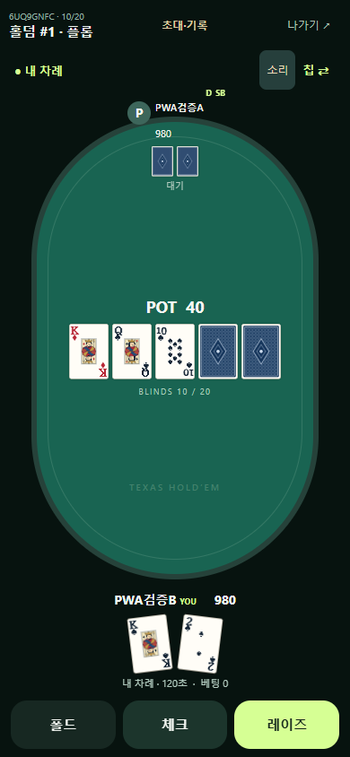

# 5단계 PWA 및 배포 준비 결과

2026-11-15 KST. 저장소 `C:/Users/jwseo/Documents/ChatGPT/앱/play-ui-refresh`, 브랜치 `main`. 1~4단계 문서와 기존 미커밋 변경을 확인하고 보존했다. `.env.local` 내용·키·세션은 출력하지 않았고 파일을 변경/커밋하지 않았다. 공개 배포, 유료 가입, 리소스 생성, 도메인 구매, 운영 Supabase 데이터 변경은 하지 않았다.

## 변경 파일

| 파일 | 이번 변경 |
| --- | --- |
| `apps/mobile/public/index.html` | Expo single-page HTML 템플릿, 한국어 lang, manifest 링크, theme color, iOS 앱 이름/standalone/status bar 메타, apple-touch-icon, 초기 viewport-fit |
| `apps/mobile/public/manifest.webmanifest` | Friends Table, root id/scope/start_url, standalone, 색상, 192/512 PNG. URL에 방 코드/토큰 없음, 웹 orientation 잠금 없음 |
| `apps/mobile/public/icons/*` | 기존 native `assets/icon.png`로부터 192·512·180px 설치 아이콘 생성 |
| `scripts/generate-web-icons.cjs` | 기존 Expo 이미지 도구를 이용한 재생성 스크립트. 신규 패키지 없음 |
| `scripts/check-web-release.cjs` | manifest/PNG 크기/HTML 링크 검증 및 선택적 배포 환경 형식 검사. 기존 endpoint/Origin 검증 재사용, 설정값 출력 없음 |
| `apps/mobile/test/pwa.test.cjs` | PWA 리소스 및 HTTPS/WSS·Origin·공개키 설정 오류 검사 2개 추가 |
| `.github/workflows/check.yml` | 웹 export 뒤 결과물 PWA 검사 추가 |
| `apps/server/src/http.ts`, `test/web-origins.test.ts` | 모든 HTTP 응답의 `Cache-Control: no-store`와 검증 추가. JWT/Origin/게임 권한 규칙 그대로 |
| `compose.yaml` | 기존 서버에 `WEB_ALLOWED_ORIGINS`, `RECONNECT_MS`, 영속 STATS 경로 전달. Origin 기본값은 계속 빈 목록 |
| `deploy/Caddyfile.web.example`, `deploy/compose.web.example.yaml`, `deploy/web-release.env.example` | 선택 가능한 HTTPS 정적 웹 + WSS 서버 예시. 기존 기본 Caddyfile은 유지 |
| `docs/web-deployment.md`, `web-device-checklist.md`, 이 문서 | 후보/비용/보안/업데이트/복귀 정책, 실제 기기 절차, 검증 범위 |
| `docs/web-phase5-browser-results.json`, `web-phase5-https-game.png` | 실제 Chrome 로컬 TLS 게임 검증 결과와 캡처 |

이전 단계부터 남아 있는 전체 Git diff와 위 목록은 다르다. 앱 패키지/lockfile, 네이티브 설정, 게임 엔진, DB 스키마는 이번에 변경하지 않았다.

## PWA 구성과 제한

Expo가 제공하는 SPA HTML 템플릿 구조를 사용하며 정적 public 파일은 개발 서버/웹 export에서 제공한다. `start_url: /`로 실행 후 기존 Supabase 세션과 서버 `currentRoom`을 통해 참여 방에 복귀한다. 방 토큰 영구 저장은 추가하지 않았다. 초대 링크 `/join/*`는 별도로 유지된다. [Expo PWA 안내](https://docs.expo.dev/guides/progressive-web-apps/)

Service Worker는 등록하지 않았다. 오프라인 게임이 필요하지 않고 installability 자체의 필수 요건이 아니므로 인증/API 캐시나 오래된 앱 코드의 SW 교체 문제를 만들지 않는다. 연결이 없으면 게임을 할 수 없고 최초 페이지 로드도 보장하지 않는다. 일반 HTTP 캐시는 별개라 배포 설정에 HTML/manifest 재검증과 API no-store를 포함했다. [MDN 설치 조건](https://developer.mozilla.org/en-US/docs/Web/Progressive_web_apps/Guides/Making_PWAs_installable)

현재 아이콘은 **기존 프로젝트의 Expo 기본 모양 자산을 재사용**한 것이다. 설치 리소스 크기는 검증했지만 최종 브랜드 디자인 작업은 하지 않았다. maskable 아이콘으로 부정확하게 선언하지 않고 `purpose: any`를 사용한다. OS에 따라 여백/마스크가 달라질 수 있다.

이 결과는 PWA 구성 및 브라우저 manifest 해석 검증이다. **실제 OS 홈 화면 설치/standalone 앱 실행이 검증됐다는 뜻은 아니다.** 설치법과 실제 기기 확인은 [체크리스트](web-device-checklist.md)를 따른다.

## 실제 Chrome 로컬 HTTPS/WSS 검증

설치된 Windows Chrome을 headless + browser sandbox 유지 상태로 실행했다. 두 독립 context에서 실제 개발 Supabase 익명 로그인과 기존 Node/ws 게임 서버를 사용했다. 앱 인증이나 게임 결과를 mock으로 대체하지 않았다. `.qa-web`의 임시 Node TLS 프록시를 루프백에만 실행하고 `qa.friendstable.test`를 해당 브라우저 안에서 127.0.0.1로 매핑했다. 공개 DNS/서버를 만들지 않았다.

테스트 인증서는 이틀 유효 자체 서명이다. QA context만 인증서 오류 예외를 적용했고 OS 신뢰 저장소는 변경하지 않았다. **공인 인증서 신뢰·발급·갱신 또는 실제 설치 조건 검증을 대신하지 않는다.** 운영에서는 이 예외를 사용하면 안 된다.

| 항목 | 실제 결과 |
| --- | --- |
| 배포용 웹 export | 로컬 QA WSS 주소를 빌드 시 주입한 production 번들 사용 |
| Manifest | Chrome `Page.getAppManifest` 파싱 오류 0, standalone 값 확인 |
| Service Worker | 새 context의 등록 수 0 |
| 인증/초대 | A 익명 로그인·닉네임·방 생성, B HTTPS 초대 링크 → 익명 닉네임 → 동일 방 입장 |
| WSS | 관찰한 게임 소켓 전부 WSS, query token 없음 |
| 게임 | 2인 시작 → Call → Check → 플롭. 팟40, 각 980칩 |
| 새로고침 | 같은 hand ID·player ID·개인 카드/칩·actor ID 복구. 상대 `cards:null` 검증 |
| 탭 종료 | B 탭 닫기 → 같은 context 새 탭 루트 URL 접속 → 기존 게임 테이블/방 코드 복구 |
| 오류 | pageerror 0. 390×844 실제 렌더링 스크린샷 확인 |
| 정리 | 최종 실행에서 양쪽 UI로 방 나가기, 독립 브라우저/TLS 프록시 종료 |

첫 실행은 위 기능 검증 뒤 정리 단계에서 테스트 스크립트가 확인 버튼을 `나가기`로 잘못 찾아 timeout됐다. 실제 버튼 `방 나가기`로 수정한 후 전체 시나리오를 다시 실행해 exit 0을 확인했다. 첫 테스트의 남은 좌석은 기존 5분 서버 만료 정책에 맡겼다. 개발 테스트 익명 계정/전적을 임의 삭제하지 않았다.

이 단계에서는 실제 네트워크 전환·기기 잠금·5분 실시간 경계·실제 앱 설치/삭제·새로운 Edge 게임 테스트를 수행하지 않았다. 해당 항목은 실기기 체크리스트에 미검증으로 남겼다. 기존 SQLite 재시작/권한/복귀 테스트는 아래 서버 회귀 테스트에 포함된다.

## 테스트 결과

| 명령/검증 | 결과 |
| --- | --- |
| 변경 전 `npm test` | 정상 로컬 권한에서 서버 172/172 |
| 변경 전 `npm run test --workspace=@boardgame/mobile` | 43/43 |
| 변경 후 `npm test` | 172/172 |
| 변경 후 `npm run test --workspace=@boardgame/mobile` | 45/45 |
| `npm run typecheck` | mobile/server/shared 통과 |
| `npm run export:web --workspace=@boardgame/mobile -- --output-dir dist-web` | 성공 |
| `npm run export:mobile` | Android/iOS Hermes 번들 성공 |
| `node scripts/check-web-release.cjs apps/mobile/dist-web` | HTML/manifest/아이콘 실제 export 검사 통과 |
| production 설정 단위 검증 | HTTPS/WSS 허용, HTTP/WS·localhost 게임 주소·URL 토큰·잘못된 키 종류·잘못된 Origin/와일드카드 거부 |
| 기존 Origin/인증 테스트 | HTTP CORS, WS upgrade 거부, 허용 Origin의 JWT 요구, native 인증 요구 통과 |
| SQLite/복귀 기존 테스트 | 같은 방/좌석/패/액션 복구, 만료 좌석 미갱신, persist 실패 시 차단 통과 |
| 로컬 Chrome HTTPS 게임 | 위 2인 시나리오 통과 |
| `git diff --check` | 통과 (기존 파일 CRLF 경고만 있음) |

처음 sandbox 실행은 로컬 프로세스/소켓 제한으로 실패하여 종료했고 정상 로컬 권한으로 재실행했다. OpenSSL도 같은 환경 제한으로 재실행했다. 테스트를 생략하거나 인증 검증을 끄지 않았다. 브라우저 QA는 기존 ignored `.qa-web` Playwright 설치를 사용했으며 앱 의존성을 추가하지 않았다. Docker/Caddy 실행기는 없어 해당 설정의 실제 구동은 미검증이다.

## 운영 준비 상태와 남은 작업

**추천:** 무료 정적 호스팅 + 절전 없는 단일 Node 서버/영속 디스크. 플랫폼은 확정하지 않았다. Render 예시는 월 약 $7.25부터, Railway는 최소 $5에 사용량 추가(계획 예산 $5~15). Supabase Pro가 필요하면 별도 $25부터 추가한다. 가격 근거·무료 플랜의 절전/데이터 손실·변수/라우팅·배포 절차는 [배포 문서](web-deployment.md)에 있다.

현재 게임 상태는 메모리 + 선택적 SQLite다. 운영 설정은 STATE_DB_PATH를 강제하지만 실제 영속 디스크가 없으면 재배포 시 데이터가 사라진다. 단일 프로세스를 유지하고 무중단/수평 확장을 가정하지 않는다. 서버 재시작 시 연결 종료와 보존 시간 경과, 게임 중 열린 탭의 구버전 JS 영향을 배포 문서에 명시했다.

Android/iOS는 테스트·번들 수준에서 회귀 통과이며 기기 설치/화면/PWA와 네이티브 혼합 플레이는 미검증이다. 웹 HTML/manifest와 선택적 배포 예시는 네이티브 UI/저장소/인증 흐름을 바꾸지 않는다. 서버 no-store는 공통 HTTP 캐시 정책만 강화한다.

다음 우선순위:

1. 호스팅·예산·지역·도메인·개발/운영 Supabase 구분 선택 후 사용자 승인.
2. 승인된 스테이징에서 공인 HTTPS/WSS·Caddy/관리형 프록시·정확한 Origin·영속 디스크 재시작 검증.
3. iPhone Safari/홈 화면, Android Chrome/홈 화면, PC Chrome/Edge 설치와 5분 복귀 실기 검증.
4. 최종 아이콘/브랜드와 익명 계정 복구 제한 안내 확인, 유지보수/백업 절차 점검 후 공개 공유 승인.

유료 가입·비용 리소스·도메인 구매·공개 운영 배포·운영 Supabase 데이터 변경·외부 비밀 키 등록은 아직 승인되지 않았으며 실행하지 않았다.
